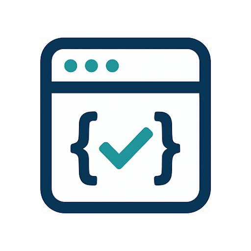

<p align="center">
  
</p>

<h1 align="center">TWD Design</h1>

<p align="center"><strong>Test While Designing.</strong><br>
The tests exist before the code.</p>

Ask in a Slack thread how a screen would look. TWD Design answers with a clickable HTML prototype that
uses your design guide, carries its acceptance criteria as [TWD](https://twd.dev) scenarios that already
pass in the page, and `DEV:` notes for whoever implements it. Iterate in the thread until the team agrees,
then it opens a pull request in your repo. Developers build until those scenarios pass.

Self-hosted and open source: your Slack app, your GitHub App, your model key. Nothing is stored.

```
design  (TWD Design)  →  build  (twd-js + twd-ai)  →  CI  (twd-cli)  →  review  (twd-relay, recordings)
```

- **Iterate in the thread.** Reply "and on mobile?" and the bot posts a new version that keeps what was agreed.
- **Uses your design.** Paste a GitHub repo link and it designs with that repo's `design/DESIGN.md`.
- **Speaks to developers.** Real routes and proposed endpoints live in `DEV:` comments; prototype-only
  scaffolding is marked `PROTOTYPE ONLY`.
- **Ships as a PR.** Say "approved, open the PR" and it commits `design/prototypes/<feature>/index.html`
  plus an `intent.md` on a new branch.
- **Stateless.** No database: the Slack thread is the history, the last attached `.html` is the current
  version, and the last GitHub link is the repo.

## How a turn works

```
Slack mention / thread reply
  → slack/app.ts      routes the event
  → slack/turn.ts     one turn: load thread, read DESIGN.md, run the agent, post the result
      → slack/thread.ts     history + current prototype + repo, all from the thread
      → github/files.ts     design/DESIGN.md from the linked repo
      → agent/agent.ts      Mastra agent with skill.md + template.html as instructions
          → agent/tools.ts  write_prototype · edit_prototype · open_pull_request
  → files.uploadV2    the new .html in the thread (or a text reply)
```

## Project structure

```
src/
  index.ts                 validates config, starts the Slack app, graceful shutdown
  config.ts                every environment variable, in one place, and its validation
  log.ts                   JSON logs
  slack/
    app.ts                 Bolt app wiring and /healthz
    events.ts              when the bot answers (mentions, follow-ups) and when it stays quiet
    thread.ts              reads the thread: history, current prototype, linked repo
    turn.ts                one bot turn, end to end
  agent/
    agent.ts               runs the Mastra agent for a turn
    tools.ts               write_prototype, edit_prototype, open_pull_request
    types.ts               shared types
    instructions.ts        loads skill.md + template.html (re-read every turn)
    skill.md               how the bot works and the rules prototypes follow
    template.html          working Alpine + Tailwind prototype the model adapts
  github/
    client.ts              GitHub App auth (JWT → installation token)
    files.ts               read repo files, find the repo linked in the thread
    pull-request.ts        branch + single commit + PR
  prototype/
    form-shim.ts           makes forms work in Slack's sandboxed preview
    edits.ts               exact, all-or-nothing edits to the prototype
test/
  flows/                   business stories, end to end: Slack thread → agent → tools → GitHub
  units/                   rules that need their edge cases spelled out (edits, links, shim, App auth)
diagnostics/
  slack-sandbox-probe.html measures what Slack's preview allows (open it in Slack)
docs/
  index.md                 documentation home
  guides/                  the way of working: your design guide (more coming)
  setup/                   Slack app, GitHub App, model
  install/                 Docker, Docker Compose, Render
  reference/               configuration, security, observability, troubleshooting
Dockerfile                 the image (node 24 slim, non-root, /healthz)
docker-compose.yml         run it on any server
render.yaml                Render blueprint (same Dockerfile)
slack-manifest.yaml        Slack app manifest (annotated: what to change, what to keep)
examples/DESIGN.md         template for your design guide
brand/                     icon for the Slack app, logo, colors
.github/workflows/         CI, and image release to GHCR on v* tags
```

## Install (about 15 minutes)

1. [Create the Slack app](docs/setup/slack-app.md) from `slack-manifest.yaml`. *5 min*
2. [Create the GitHub App](docs/setup/github-app.md) (optional: design guide and pull requests). *5 min*
3. [Choose a model](docs/setup/models.md) and get its API key.
4. Configure and run:

   ```bash
   cp .env.example .env     # fill it in: docs/reference/configuration.md
   docker compose up -d     # or docker run, or Render
   docker compose logs -f   # wait for {"msg":"ready",...}
   ```

   Guides: [Docker](docs/install/docker.md) · [Docker Compose](docs/install/docker-compose.md) · [Render](docs/install/render.md)

5. Invite the bot to a channel (`/invite @twd-design`) and mention it.

Something not working? [Troubleshooting](docs/reference/troubleshooting.md).

### Development

```bash
npm install
npm run dev        # Node 24+, restarts on code changes
npm run typecheck
npm test           # node:test, no network, about 2 seconds
```

Most tests are **stories**: a fake Slack channel where people post, a fake GitHub repo, and a scripted
model that decides which tools to call. Everything in between is the real code, so a failing test reads
like a broken promise to the team: *"Ana approves: a PR with the latest version and its intent, linking
back to the thread"*. No network, about 2 seconds.

The scripted model only replays decisions; whether the real model makes good ones is the job of evals.

## Operating it

- **Configuration**: environment variables only, validated at startup. Reference:
  [docs/reference/configuration.md](docs/reference/configuration.md).
- **Security and data**: nothing is stored; what goes where is in [docs/reference/security.md](docs/reference/security.md).
- **Health check**: `GET /healthz` on `PORT` (3000), in both Socket Mode and HTTP mode.
- **Logs**: one JSON object per line. Each bot turn logs duration, tools used and token usage.
- **Shutdown**: on `SIGTERM` the bot stops taking turns and lets running ones finish
  (`SHUTDOWN_TIMEOUT_MS`, 60 s) before exiting.
- **State**: none. Restart, redeploy or scale down at any time; the threads hold everything.

## License

[MIT](LICENSE) © BRIKEV
